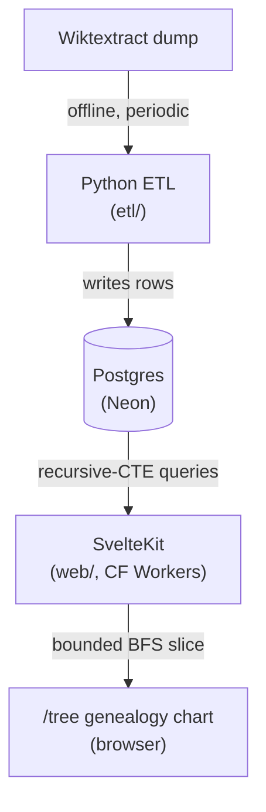
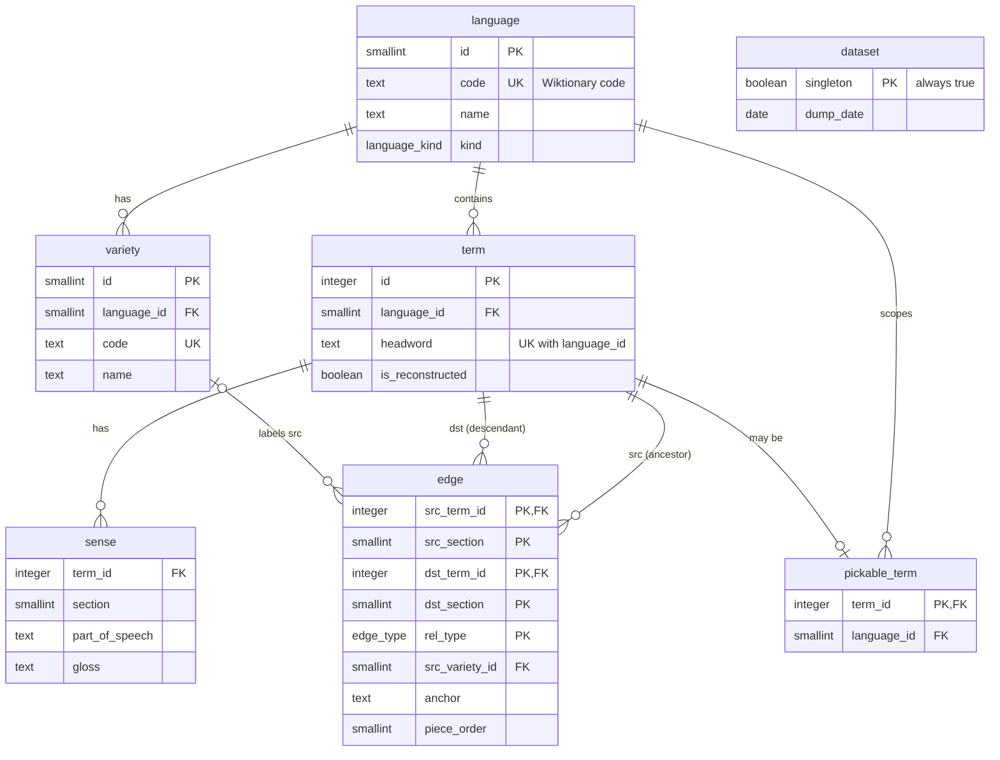
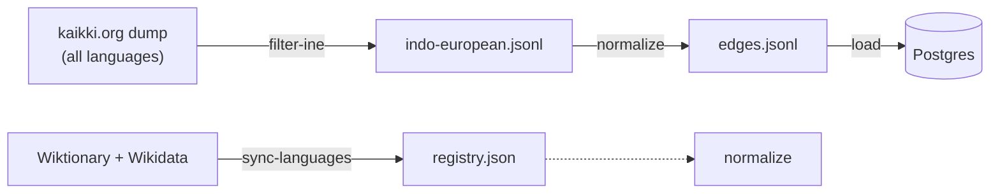

# Architecture

_Last updated: 2026-10-10_

How etymyriad is built, and why. This document records the foundational,
hard-to-reverse decisions and the mechanics behind them. The backlog on the
GitHub Project tracks features and plans. The look and feel of the UI lives
in [`DESIGN.md`](DESIGN.md).

## 1. Purpose

Show where words come from: a bounded family tree of a word's ancestors and
descendants, backed by a sourced, citable dataset. The audience is a mix of
a portfolio/learning showcase and a public tool for language enthusiasts,
with research-grade accuracy as a guiding constraint.

## 2. Guiding principle

The one irreversible asset is the data model and the ingestion pipeline.
Everything downstream (database host, API, frontend, AI) plugs into a
stable data layer and can be swapped. So the schema is provenance-first and
protected accordingly.

## 3. Scope (v1)

- The Indo-European language family. It has the best Wiktionary coverage,
  the richest cognate and backtrace chains, and the largest audience. Other
  families can follow later.
- No AI in v1 (see §12).

## 4. System overview



Two languages, each where it is strongest, with Postgres as the boundary:

- ETL in Python. Wiktextract is a Python project, and the data-wrangling
  and NLP ecosystem is Python-first. The ETL runs offline and only writes
  rows, so it shares no code with the app.
- API and frontend in TypeScript with SvelteKit. One codebase for the
  product, with types shared between server routes and UI. SvelteKit's
  `+server.ts` routes are the API, and they query Postgres directly. There
  is no separate service.

| Path                 | Contents                                          |
| -------------------- | ------------------------------------------------- |
| `etl/`               | Python ETL (uv, src layout), CLI `etymyriad`      |
| `db/schema.sql`      | Canonical DDL                                     |
| `db/migrations/`     | `0001_baseline.sql`, identical to `schema.sql`    |
| `web/`               | SvelteKit app: pages, API routes, tree layout     |
| `web/e2e/`           | Playwright specs                                  |
| `.github/workflows/` | CI, CD, and the manual ETL reload                 |

A test (`etl/tests/load/test_schema.py`) keeps the baseline migration
byte-identical to `schema.sql`. A schema change also has to reach
`etl/src/etymyriad/model.py`, the loader in `etl/src/etymyriad/load/`, and
`web/src/lib/shared/types.ts`.

## 5. Data source

- Wiktextract / kaikki.org (Tatu Ylönen) is the only source. It is a
  machine-readable JSON extraction of Wiktionary. The ETL reads each
  entry's `etymology_templates` and its senses' `form_of` links.
- The project builds its own normalized database. It never queries
  Wiktionary live.
- The derived dataset inherits Wiktionary's CC BY-SA 4.0 license. The
  README's Licensing section covers attribution and share-alike duties.

## 6. Data model

`db/schema.sql` is the authoritative DDL. The model is a directed,
provenance-carrying graph: a `term` is a node, and an `edge` runs
`src -> dst`, meaning ancestor -> descendant.



`dataset` holds one row and has no foreign keys. `source_ref()` reads it to
build every citation.

### Tables

- `language` and `variety`: one row per Wiktionary language code, with its
  name and kind (regular, reconstructed, appendix-constructed, or
  collective). A variety is an etymology-only lect such as `la-lat`.
  Wiktionary files its terms under the full language, so a variety only
  labels an edge's `src`.
- `dataset`: the dump date of the loaded generation.
- `term`: a headword in one language. Its identity is the pair
  (language, headword); sections and varieties belong to the edge or sense
  that mentions it. `is_reconstructed` marks proto-forms. A term with no
  `sense` rows is a redlink, known only from another page's templates.
- `sense`: a term's section, part of speech, and gloss. The ETL keeps one
  sense per Wiktextract entry: the first gloss and the entry's part of
  speech.
- `edge`: a directed, typed relation. Each end carries a section, and each
  edge carries an `anchor` into the dst page that states it. A section is
  Wiktionary's "Etymology N" number, stored only where the source states
  it; 0 means unspecified. `piece_order` is the 1-based position of a
  morpheme in a multi-piece template. A check constraint forbids
  self-loops, since a tree node cannot be its own parent.
- `pickable_term`: real entries (at least one sense) with at least one
  non-mention edge. The random-word button draws from it. The loader
  builds it once per load.

### Edge types

`edge_type` mirrors the relations Wiktionary encodes in its etymology
templates. The ETL maps template names as follows.

| `edge_type`              | Templates                                  |
| ------------------------ | ------------------------------------------ |
| `inherited`              | `inh`, `inherited`, `inh+`, `inh-lite`     |
| `borrowed`               | `bor`, `borrowed`, `bor+`, `ubor`, `obor`  |
| `learned_borrowing`      | `lbor`, `learned borrowing`                |
| `semi_learned_borrowing` | `slbor`                                    |
| `derived`                | `der`, `derived`, `der+`, `der-lite`, `uder` |
| `root`                   | `root`                                     |
| `affix`                  | `af`, `affix`, `prefix`, `suffix`, `suf`, `infix` |
| `compound`               | `com`, `compound`                          |
| `calque`                 | `cal`, `calque`, `clq`, `pcal`, `partial calque` |
| `semantic_loan`          | `sl`, `semantic loan`                      |
| `transliteration`        | `translit`, `transliteration`              |
| `mention`                | `m`, `mention`, `m+`                       |
| `surface_analysis`       | `surf`                                     |
| `inflection`             | a sense's `form_of` link (lemma -> form)   |

`{{etymon}}` and its older alias `{{ety}}` carry their relations as
`:code` arguments. A code applies to every term after it until the next
code, and terms before any code map to `derived`. Several terms under
`affix`, `blend`, `univerbation`, or `surface_analysis` are ordered pieces
and carry a `piece_order`. A term's inline `<ety:...>` chain uses the same
codes.

| `edge_type`              | `{{etymon}}` codes                                   |
| ------------------------ | ---------------------------------------------------- |
| `inherited`              | `inh`                                                |
| `borrowed`               | `bor`, `ubor`, `obor`                                |
| `learned_borrowing`      | `lbor`                                               |
| `semi_learned_borrowing` | `slbor`                                              |
| `derived`                | `der`, `derived`, `from`, `vrd`, `uder`, `deverbal`, `denominal`, `denom`, `nom`, `nominalization` |
| `root`                   | `root`                                               |
| `affix`                  | `af`, `affix`, `sa-af`, `vrd-af`                     |
| `surface_analysis`       | `afeq`                                               |
| `calque`                 | `calque`, `cal`, `clq`, `pcal`, `partial calque`     |
| `blend`                  | `blend`                                              |
| `univerbation`           | `univ`, `univerbation`                               |
| `shortening`             | `clip`, `clipping`, `bf`, `back-formation`, `ellipsis`, `ellip`, `abbr`, `abbrev`, `abbreviation`, `acro`, `init`, `sylabbr`, `apheretic` |
| `reduplication`          | `redup`, `reduplication`                             |
| `metathesis`             | `metathesis`                                         |
| `transliteration`        | `translit`, `transliteration`                        |
| `semantic_loan`          | `sl`, `semantic loan`                                |
| `influence`              | `influence`                                          |

The ETL ignores every other template, such as `cog` or `unk`.

Tree walks skip `mention` edges.

### Citations

`source_ref()` turns a language code, a headword, an anchor, and a section
into a full citation:

```text
wiktionary:2026-09-02:en:word#etymology_templates:0:af
wiktionary:2026-09-02:en:bank:2#etymology_templates:0:inh
```

An anchor is `etymology_templates:<index>:<template>` for a template or
`senses:<index>:form_of` for an inflection. Its template index counts
within one section, so a nonzero section goes after the headword. The
function reads the dump date from `dataset`, so the citation format lives
in one place. It uses `to_char` so the session's `DateStyle` cannot change
the output.

### Sizes

A full local load of the 2026-09-02 dump measured these sizes. They are a
reference point, not live counts.

| Table or measure                  | Value     |
| --------------------------------- | --------- |
| terms                             | 8,298,276 |
| edges                             | 3,022,230 |
| senses                            | 8,408,934 |
| pickable terms                    | 1,605,889 |
| redlink terms                     | 349,701   |
| edges with a numbered dst section | 191,010   |
| edges with a src section          | 0         |
| edges via a variety               | 73,893    |
| languages                         | 1,461     |
| varieties                         | 201       |

On disk, `sense` takes 853 MB, `term` 848 MB, `edge` 398 MB, and
`pickable_term` 124 MB. The whole database is 2.2 GB.

## 7. ETL pipeline



### Commands

| Command          | Reads                   | Writes                         |
| ---------------- | ----------------------- | ------------------------------ |
| `filter-ine`     | full dump (`.gz` ok)    | Indo-European JSONL            |
| `sync-languages` | Wiktionary and Wikidata | `languages/registry.json`      |
| `parse`          | the dump                | nothing; prints a count        |
| `normalize`      | the dump                | `data/edges.jsonl`             |
| `load`           | the edge file           | Postgres                       |
| `all`            | the dump                | normalize if stale, then load  |

`all` re-normalizes only when the edge file is older than the dump, or with
`--force-normalize`. It compares modification times, so a parser change
needs the flag. `load --skip-sanity-gate` lets a load past the 10% drift
gate (see Load).

| Variable                | Default                       | Used by          |
| ----------------------- | ----------------------------- | ---------------- |
| `DATABASE_URL`          | the local dev DB              | `load`, `all`    |
| `WIKTEXTRACT_DUMP`      | `data/raw/indo-european.jsonl` | every reader    |
| `WIKTEXTRACT_DUMP_DATE` | none                          | `load`, `all`    |

`load` and `all` exit if the dump date is unset. A malformed date fails
every command. The dump default resolves against the repo root. The
`--output` of `filter-ine` and the `--edges` of `normalize` default to
paths relative to the working directory instead.

### Language registry

`sync-languages` builds `etl/src/etymyriad/languages/registry.json` from
two sources:

- Wiktionary's `Module:JSON data` exports for languages, families, and
  etymology-only varieties, fetched through the MediaWiki API.
- Wikidata's ISO 639 codes, fetched with SPARQL and joined by code.

It validates the result and writes it atomically, so a failed sync leaves
the committed file intact. Run it once per dump refresh and commit the
diff. The reload workflow refreshes it too, without committing.

Code resolution tries a table of drift aliases (renamed codes such as
`sa-cls` -> `cls`), then Wiktionary's shorthand codes (`LL.` -> `la-lat`
and similar), then the raw code. A case-insensitive match counts only when
the base subtag matches exactly. Every family code also registers as a
`collective` language.

`filter-ine` keeps an entry when its language's lineage reaches the `ine`
family. A code the registry does not know falls back to the part before
its first `-`. Only each language's code, name, and kind reach the
database. The registry's ISO codes, scripts, and Wikidata IDs are unused
for now.

### Normalize

Normalize streams the dump once and writes `data/edges.jsonl`.

- Each entry is validated with pydantic, ignoring fields it does not use.
  An invalid entry or a malformed JSON line is skipped with a warning.
- The entry itself is the edge's `dst`. Its section is the entry's
  `etymology_number`.
- Each mapped template yields one edge per ancestor. A comma-joined
  language list gives one edge per language. Affix-family templates give
  one edge per morpheme with its `piece_order`, and add the implied dash
  to prefixes, suffixes, and infixes.
- A term is reconstructed when its headword starts with `*`, when its
  language code is a reconstructed one, or when the entry sits on a
  `Reconstruction:` page.
- A sense's `form_of` link yields an `inflection` edge from the lemma to
  the form. It is kept only when some other edge cites that form as an
  ancestor, so inflections enter the graph only where they matter. These
  edges are spooled to a temp file and written last. A page made only of
  form-of senses skips its own templates, since Wiktionary copies them
  from the lemma.
- An entry that yields no structural edge is written as a lone term, so
  its senses still load.
- Self-loops are dropped. Duplicates are left for the load to remove.

Each line of the edge file is one JSON object. An edge has a `rel_type`
key; a lone term does not.

### Load

A load builds a whole new generation in a `loading` schema while the site
keeps reading `public`, then swaps the two.

1. Lock. A Postgres advisory lock stops a second load from running at the
   same time.
2. Schema. Recreate `loading`, run `db/schema.sql` in it, add unlogged
   staging tables, and drop the indexes and constraints that would slow
   the bulk insert.
3. Stage. Stream the edge file once, with two parallel `COPY` streams for
   terms and edges.
4. Merge. Insert languages, varieties, and the `dataset` row, then terms,
   senses, and edges. Edges are deduplicated on the primary key, keeping
   the one from the earliest template on the page. A senseless stub that
   differs from a real entry only by a macron or breve folds into that
   entry.
5. Unknown-language gate. Fail if more than 0.1% of staged edges name a
   code missing from the registry. A handful (one today) is a Wiktionary
   typo, so the load drops those edges with a warning. The fix for a real
   failure is `sync-languages` and a reload. There is no bypass.
6. Indexes. Rebuild the deferred indexes and constraints.
7. Build `pickable_term`, then `VACUUM (ANALYZE)` the big tables.
8. Sanity gate. Fail if the term or edge count moved more than 10% from
   the live generation. The first load into an empty database skips it.
9. Swap. In one transaction with a 5 s lock timeout, drop `public` and
   rename `loading` to `public`. A lock timeout retries after 5 s and then
   15 s.

Any failure before the swap drops `loading` and leaves `public` alone. The
swap drops the old generation, so rolling back means Neon's 6 h instant
restore or reloading the previous dump. Locally, `make db-snapshot` and
`make db-restore` give the same rewind.

### Reloads

Production reloads run as the manual "ETL reload" GitHub Actions workflow.
It takes a reason and an optional sanity-gate skip, and runs these steps:

1. Refresh the language registry.
2. Read the dump date from kaikki.org's download page. kaikki.org serves
   only its latest dump at an undated URL, so the workflow reads the date
   again after the download and fails if it changed.
3. Restore the raw dump from the Actions cache, keyed by dump date, or
   download it.
4. Filter to Indo-European. The ~14 GB output is too big for the 10 GB
   cache quota, so every run filters again.
5. Normalize, then load into Neon with the dump date set.

The raw dump, the filtered dump, and the edge file come to about 20 GB, so
the workflow logs free disk after each heavy step.

On local data, normalize took 10.5 minutes and load took 6. Loading
straight into Neon takes much longer, because the merge and the index
builds run on a small compute. If that becomes a problem, run the whole
load against local Postgres and ship only the finished schema:

```sh
pg_dump -Fc -n loading "$LOCAL_DATABASE_URL" -f loading.dump
pg_restore -j 4 --no-owner -d "$NEON_DATABASE_URL" loading.dump
```

Then run the same swap on Neon. Neon only copies rows and rebuilds
indexes, so the load gets shorter, and so does the window where both
generations take up storage. This path isn't built yet.

## 8. Web app

### Pages

| Route                    | Behavior                                    |
| ------------------------ | ------------------------------------------- |
| `/`                      | Landing card over a static preview tree     |
| `/tree/[lang]/[headword]` | The tree for one word, or a homograph picker |

The landing page's preview is a checked-in snapshot of English "etymology"
(`web/src/lib/tree/defaultTree.ts`), so it makes no database call.

The tree page's load runs on the server and in the browser. It calls
`/api/terms` for the word. No match shows a not-found message. Several
matches (one per etymology section) show a homograph picker. One match
fetches the tree slice and the term's details in parallel. `?etym=N`
selects a section; an invalid value is ignored, and a section with no
match falls back to the plain word. URLs never end in a slash.

### API

All routes are `GET` and live under `web/src/routes/api/`.

| Route (`/api/`)    | Parameters                            | Returns         |
| ------------------ | ------------------------------------- | --------------- |
| `languages`        | none                                  | pickable langs  |
| `terms`            | `lang`, `headword`, `section?`        | one per section |
| `terms/:id`        | none                                  | term and senses |
| `terms/random`     | `lang?`                               | a random word   |
| `trees/:id`        | `section?`                            | a tree slice    |
| `trees/:id/expand` | `dir`, `depth`, `exclude`, `section?` | more children   |

`languages` lists only languages with a pickable term. `terms/:id`
includes the term's citation.

Errors are JSON `{message}`: 400 for a bad parameter, 404 for a bad or
missing id, 405 for a wrong method, and 429 when rate limited.
`/api/terms` returns `[]` for no match. `/api/languages` is the only
response with a cache header (one day).

### Traversal

Never render the whole graph. `/api/trees/:id` walks ancestors and
descendants outward from the focus word with two Postgres recursive CTEs:
ancestors follow `dst -> src`, and descendants follow `src -> dst`. Depth
is signed: negative for ancestors, 0 for the focus, positive for
descendants.

- Fan-out is capped per parent at each hop (10, `MAX_SIBLINGS_PER_PARENT`
  in `web/src/lib/tree/layout/coreSelection.ts`). A fixed total node count
  would let a hub crowd out the focus word's own neighborhood. With a
  per-parent cap, a node with a huge fan-out (English "-ly", 15k+ direct
  descendants) never inflates the query.
- Children are ranked by relation priority, then by id. The priority runs
  inherited, borrowed, learned borrowing, semi-learned borrowing,
  transliteration, derived, shortening, metathesis, inflection, calque,
  semantic loan, compound, blend, univerbation, affix, reduplication,
  surface analysis, root, influence. `mention` has no priority, so the
  walk never follows it. The same order lives in
  `queries.ts` and in the client's `parentEdges.ts`, and the two must
  match.
- A section of 0 on either side of a hop matches any section.
- The walk has no depth limit for callers. A 100-hop ceiling breaks the
  one known cycle in the data (Sanskrit "कागद" and its namesakes in Hindi
  and three other languages cite each other). A survey of 2,000 terms
  found no real chain longer than 11 hops.
- A node reached by several paths keeps its shortest depth.
- Each returned edge gets its citation from `source_ref()` on the dst
  term, computed over the bounded result only.
- A parent with more than 10 children reports an overflow count. The UI
  shows it as "+N more", and clicking it calls
  `/api/trees/:id/expand` with the parent's depth and the ids it already
  has.

Filtering by `rel_type` or language is future work. The full graph stays
in Postgres, and the browser only ever sees a focused slice.

### Tree layout

The browser lays out the slice deterministically, with no physics and no
server-computed coordinates (`web/src/lib/tree/layout/`).

1. Merge parallel edges between the same two terms.
2. Split the slice into an ancestor half and a descendant half. The focus
   belongs to both.
3. Give each node one placing edge toward the focus, by relation
   priority. A node linked by a lineage edge to a same-depth neighbor
   hangs off that neighbor instead.
4. Keep at most 10 children per parent, ranked the same way, unless the
   user expanded that parent.
5. Lay out each half with d3-hierarchy's `tree()`, at 80 px per
   generation, with siblings in a fixed order: morphemes in word order,
   then alphabetical, then the "+N more" marker. Flip the ancestor half
   above the focus.
6. Draw each edge as a cubic curve from a port on the parent's bottom
   border to the top of the child, with the relation's abbreviation at
   its midpoint.

d3-zoom handles pan and zoom. The initial fit keeps the scale between 0.5
(the legibility floor) and 2.

### Server internals

- Database client (`web/src/lib/server/db.ts`). It is created lazily, so
  the build needs no `DATABASE_URL`. In dev it imports the `postgres`
  package for a TCP connection to local Postgres, with prepared
  statements off, since a generic plan turns the random-word probe into a
  sequential scan. In production it uses Neon's HTTP driver, because
  Workers cannot open raw TCP sockets.
- Rate limiting (`web/src/hooks.server.ts`). In production, every
  `/api/*` request passes two Cloudflare rate-limit bindings: 60 per
  minute per IP (`RL_API`) and 1,200 per minute site-wide (`RL_GLOBAL`).
  The site-wide pool bounds Neon compute cost, which per-IP limits alone
  cannot. A denied request gets 429 with `Retry-After: 60`.
- Security headers. Every response sets
  `Referrer-Policy: strict-origin-when-cross-origin` and
  `X-Frame-Options: DENY`. `svelte.config.js` sets a CSP that allows only
  the site itself and Google Fonts, with a nonce for the inline theme
  script.
- Random word. `/api/terms/random` picks a random id within
  `pickable_term`'s range and takes the next row, which avoids
  `ORDER BY random()` at the cost of a skew from id gaps.
- Shared types. `web/src/lib/shared/types.ts` mirrors the schema, and its
  relation labels mirror `model.py`.

## 9. Hosting and deployment

| Concern              | Choice                                              |
| -------------------- | --------------------------------------------------- |
| Database             | Neon (serverless Postgres, pay-as-you-go)           |
| App (frontend + API) | Cloudflare Workers (`adapter-cloudflare`)           |
| Domain               | etymyriad.com, registered at Cloudflare or Porkbun  |
| Local dev DB         | Native Postgres via `systemctl` (no container)      |

Roughly $0/month until real traffic, then a few dollars. The domain fronts
everything and is portable, so none of this is locked in.

Pushing a `v*` tag deploys the site (`.github/workflows/cd.yml`). The job
refuses a tag that is not on `main`, builds the app, and runs
`wrangler deploy`. The Worker's `DATABASE_URL` is a Cloudflare secret.
`make release-bump-commit VERSION=vX.Y.Z` prepares the version bump,
changelog, and tag.

## 10. Testing and CI

| Suite            | Command            | Needs                           |
| ---------------- | ------------------ | ------------------------------- |
| ETL              | `uv run pytest`    | `pg_ctl` (spawns its own DB)    |
| Web server tests | `npm run test`     | a loaded local DB               |
| Web client tests | `npm run test`     | nothing (jsdom)                 |
| End to end       | `npm run test:e2e` | a loaded local DB               |

Playwright starts the dev server itself unless one is already running.

The web server tests run queries and route handlers against the real
local database. They insert `zzz-*` fixture rows and delete them
afterwards. The client tests render Svelte components in jsdom.

CI (`.github/workflows/ci.yml`) runs on pushes to `main` and `dev` and on
pull requests. It runs ruff, ty, and pytest for the ETL, and Prettier,
ESLint, `svelte-check`, and a build for the web app. It does not run
vitest or Playwright, since both need a loaded database.
`make release-preflight` runs the CI checks plus vitest locally.

## 11. Known limits

- The ETL never resolves a src section, so no edge stores one.
- Each entry keeps only its first gloss.
- An entry's own variety is dropped; only an edge's src can carry one.
- `{{etymon}}` contributes only its first relation.
- Unmapped templates are dropped without a count.
- The unknown-language gate counts edges only, so lone terms in unknown
  languages vanish unreported.
- The 100-hop walk ceiling is a loop breaker, not real cycle detection.
- The random word skews toward terms after gaps in the id sequence.
- Node widths come from an average of 7 px per character.

## 12. AI (deferred)

Designed-for, not built. Because the data is structured and sourced, AI
can later add natural-language search and prose summaries without touching
the graph. The graph itself stays deterministic and citable. AI never
generates etymological facts.
