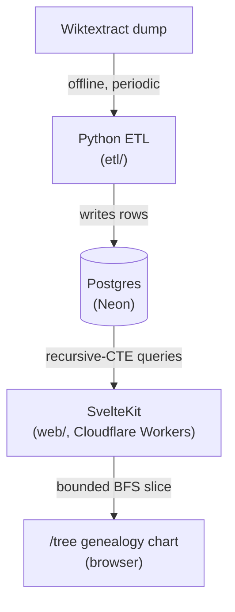
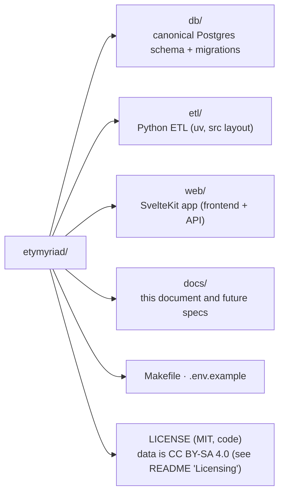

# Etymyriad: Foundation Design

_Last updated: 2026-08-23_

This document records the foundational, hard-to-reverse decisions for the
project. Feature-level designs (graph UI, country map, backtraces) are separate
follow-on specs. This is only the bedrock.

## 1. Purpose

An etymology **network visualizer**: explore the ancestry, descendants, and
cognates of words as an interactive graph, backed by a **sourced, citable**
dataset. Audience is a mix of a portfolio/learning showcase and a public tool
for language enthusiasts, with research-grade accuracy as a guiding constraint.

## 2. Guiding principle

The one genuinely irreversible asset is the **data model + ingestion pipeline**.
Everything downstream (database host, API, frontend, AI) plugs into a stable
data layer and can be swapped. So the schema is designed to be storage-agnostic
and provenance-first, and protected accordingly.

## 3. Scope (v1)

- **Indo-European** language family. Best Wiktionary coverage, richest cognate
  and backtrace chains, largest audience. Expand to other families later.
- No AI in v1 (see §9).

## 4. Architecture



Two languages, each where it is strongest, with Postgres as the clean boundary:

- **ETL, Python.** Wiktextract is a Python project, and the data-wrangling
  and future NLP/AI ecosystem is Python-first. The ETL is isolated: it runs
  offline and only writes rows, so it shares no code with the app.
- **API + Frontend, TypeScript / SvelteKit.** One codebase for the product,
  with types shared between server routes and UI. SvelteKit's server routes
  _are_ the API (no separate service), querying Postgres directly.

## 5. Data sources

- **Wiktextract / kaikki.org** (Tatu Ylönen): primary. Machine-readable JSON of
  Wiktionary with `etymology_templates`, `descendants`, and citations.
- **Etymological Wordnet** (de Melo): used only to validate the parser.
- The project builds its **own normalized database**. It never queries
  Wiktionary live.

## 6. Data model

See `db/schema.sql` for the authoritative DDL. Summary:

- **`lexeme`** (node): a word/morpheme in one language. Carries `lang_code`,
  `headword`, optional `gloss`/`pos`/`romanization`, `is_reconstructed` (for
  proto-forms), and a `source_ref`.
- **`etymology`** (edge): a directed, typed relation `src → dst` (ancestor →
  descendant), with a `rel_type` enum mirroring Wiktionary's relations
  (inherited, borrowed, derived, root, affix, calque, cognate, …) and a
  per-edge `source_ref` citation.
- **Traversals**: `/tree`'s genealogy view walks ancestors and
  descendants outward from the focus word with a Postgres recursive CTE,
  capping fan-out per parent at each hop (see §7). Nodes are laid out by
  BFS depth and sibling order, not spatial coordinates. Trigram index for
  search.

## 7. Anti-noise principle

Never render the whole graph. `/tree` walks ancestors and descendants
outward from the focus word with a recursive CTE, capping fan-out **per
parent at each hop** (ETYM-144) rather than bounding by a fixed total
node count -- so a node with a massive fan-out (e.g. English "-ly", 15k+
direct descendants) never inflates the query itself, and the focus
word's own neighborhood is always represented regardless of its
connectivity. Nodes are laid out deterministically by BFS depth and
sibling order, no physics, no server-precomputed spatial coordinates.
Filtering by `rel_type`/language and further "+N more" expansion on
demand remain future anti-noise UX work. The full graph stays in
Postgres, and the browser only ever sees a focused slice.

## 8. Hosting

| Concern              | Choice                                                    |
| -------------------- | --------------------------------------------------------- |
| Database             | **Neon** (serverless Postgres, pay-as-you-go)             |
| App (frontend + API) | **Cloudflare Workers** (SvelteKit via `adapter-cloudflare`) |
| Domain               | **etymyriad.com**, registered at Cloudflare or Porkbun    |
| Local dev DB         | Native Postgres via `systemctl` (no container)            |

Roughly $0/month until real traffic, then a few dollars. The domain fronts
everything and is portable, so none of this is locked in.

### Reloads

A reload builds the next generation in a `loading` schema while the site
keeps reading `public`, then swaps the two.

Loading straight into Neon takes a long time, because the merge and the
index builds run on a small compute. If that becomes a problem, run the
whole load against local Postgres and ship only the finished schema:

```sh
pg_dump -Fc -n loading "$LOCAL_DATABASE_URL" -f loading.dump
pg_restore -j 4 --no-owner -d "$NEON_DATABASE_URL" loading.dump
```

Then run the same swap on Neon. Neon only copies rows and rebuilds
indexes, so the load gets shorter, and so does the window where both
generations take up storage. This path isn't built yet. Measure a load
under the v0.5.0 schema before building it.

## 9. AI (deferred)

Designed-for, not built. Because the data is structured and sourced, AI can
later be added for natural-language search and prose summaries **without**
touching the graph. The graph itself stays deterministic and citable. AI never
generates etymological facts.

## 10. Roadmap (follow-on specs)

Each becomes a read over the same schema:

- Individual word breakdown pages (SEO-friendly, statically generated).
- Linear backtrace view for any word in any language.
- Word → country/region map (geography of origins).
- Cognate explorer, filters, search.

## 11. Repo layout


