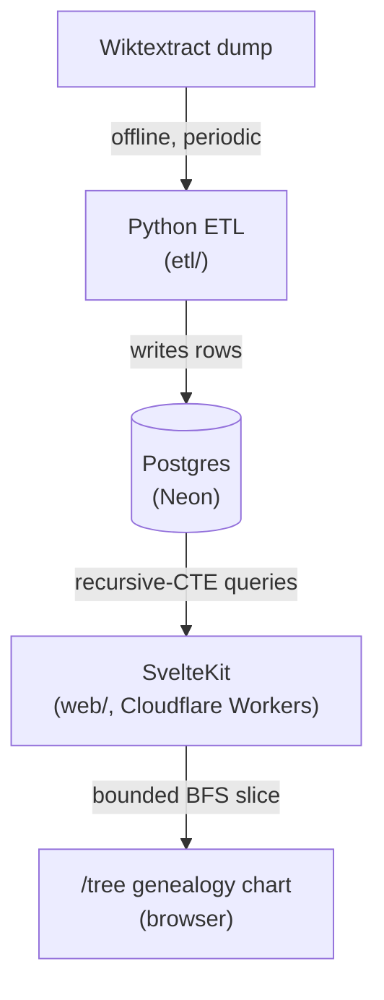

# Etymyriad: Foundation Design

_Last updated: 2026-10-10_

This document records the foundational, hard-to-reverse decisions for the
project. The backlog on the GitHub Project tracks features and plans.

## 1. Purpose

Show where words come from: a bounded family tree of a word's ancestors and
descendants, backed by a **sourced, citable** dataset. Audience is a mix of a
portfolio/learning showcase and a public tool for language enthusiasts, with
research-grade accuracy as a guiding constraint.

## 2. Guiding principle

The one genuinely irreversible asset is the **data model + ingestion pipeline**.
Everything downstream (database host, API, frontend, AI) plugs into a stable
data layer and can be swapped. So the schema is provenance-first and protected
accordingly.

## 3. Scope (v1)

- **Indo-European** language family. Best Wiktionary coverage, richest cognate
  and backtrace chains, largest audience. Expand to other families later.
- No AI in v1 (see §9).

## 4. Architecture



Two languages, each where it is strongest, with Postgres as the clean boundary:

- **ETL, Python.** Wiktextract is a Python project, and the data-wrangling
  and future NLP/AI ecosystem is Python-first. The ETL is isolated: it runs
  offline and only writes rows, so it shares no code with the app.
- **API + Frontend, TypeScript / SvelteKit.** One codebase for the product,
  with types shared between server routes and UI. SvelteKit's server routes
  _are_ the API (no separate service), querying Postgres directly.

## 5. Data sources

- **Wiktextract / kaikki.org** (Tatu Ylönen): the only source. Machine-readable
  JSON of Wiktionary; the ETL reads each entry's `etymology_templates` and its
  senses' `form_of` links.
- The project builds its **own normalized database**. It never queries
  Wiktionary live.

## 6. Data model

See `db/schema.sql` for the authoritative DDL. Summary:

- **`language`** and **`variety`**: one row per Wiktionary language code
  with its name and kind (regular, reconstructed, appendix-constructed,
  or collective). A variety is an etymology-only lect such as `la-lat`.
  Wiktionary files its terms under the full language, so a variety only
  labels an edge's `src`.
- **`dataset`**: one row holding the dump date of the loaded generation.
- **`term`** (node): a headword in one language, with `is_reconstructed`
  for proto-forms. A term with no `sense` rows is a redlink, known only
  from another page's templates.
- **`sense`**: a term's section, part of speech, and gloss, one row per
  Wiktextract entry.
- **`edge`**: a directed, typed relation `src -> dst` (ancestor ->
  descendant), with an `edge_type` enum mirroring Wiktionary's templates
  (inherited, borrowed, derived, root, affix, calque, and so on). Each end
  carries a section, and each edge carries an `anchor` into the page that
  states it. A section is Wiktionary's "Etymology N" number, stored only
  where the source states it. 0 means unspecified.
- **`pickable_term`**: the real entries with at least one non-mention
  edge, which the random-word button draws from. Built once per load.
- **`source_ref()`**: a SQL function that turns a language code, a
  headword, and an `anchor` into a full citation such as
  `wiktionary:2026-09-02:en:word#etymology_templates:0:af`. It reads the
  dump date from `dataset`, so the citation format lives in one place.
- A full local load of the 2026-09-02 dump measured these sizes (not
  live counts):

  | Table or measure                  | Value     |
  | --------------------------------- | --------- |
  | terms                             | 8,298,276 |
  | edges                             | 3,022,230 |
  | senses                            | 8,408,934 |
  | pickable terms                    | 1,605,889 |
  | redlink terms                     | 349,701   |
  | edges with a numbered dst section | 191,010   |
  | edges with a src section          | 0         |
  | edges via a variety               | 73,893    |
  | languages                         | 1,461     |
  | varieties                         | 201       |

  The ETL does not resolve a src section yet, so no edge stores one.
  On disk, `sense` takes 853 MB, `term` 848 MB, `edge` 398 MB, and
  `pickable_term` 124 MB. The whole database is 2.2 GB.
- **Traversals**: `/tree`'s genealogy view walks ancestors and
  descendants outward from the focus word with a Postgres recursive CTE,
  capping fan-out per parent at each hop (see §7). Nodes are laid out by
  BFS depth and sibling order, not spatial coordinates.

## 7. Anti-noise principle

Never render the whole graph. `/tree` walks ancestors and descendants outward
from the focus word with a recursive CTE, capping fan-out **per parent at each
hop** rather than bounding by a fixed total node count. So a node with a
massive fan-out (e.g. English "-ly", 15k+ direct descendants) never inflates
the query itself, and the focus word's own neighborhood is always represented
regardless of its connectivity. Nodes are laid out deterministically by BFS
depth and sibling order, no physics, no server-precomputed spatial
coordinates. A parent with more children than the cap shows a "+N more"
control that fetches the rest on demand. Filtering by `rel_type` or language
is future work. The full graph stays in Postgres, and the browser only ever
sees a focused slice.

## 8. Hosting

| Concern              | Choice                                                    |
| -------------------- | --------------------------------------------------------- |
| Database             | **Neon** (serverless Postgres, pay-as-you-go)             |
| App (frontend + API) | **Cloudflare Workers** (SvelteKit via `adapter-cloudflare`) |
| Domain               | **etymyriad.com**, registered at Cloudflare or Porkbun    |
| Local dev DB         | Native Postgres via `systemctl` (no container)            |

Roughly $0/month until real traffic, then a few dollars. The domain fronts
everything and is portable, so none of this is locked in.

### Reloads

A reload builds the next generation in a `loading` schema while the site
keeps reading `public`, then swaps the two and drops the old generation. A
failed run drops `loading` and leaves `public` alone.

Two gates run before the swap. The unknown-language gate fails the load
when edges naming a code missing from the registry exceed 0.1% of staged
edges. A handful (one today) is a Wiktionary typo, so the load drops
those edges with a warning. The sanity gate fails the load when the term
or edge count moves more than 10% from the live generation;
`--skip-sanity-gate` overrides it for a deliberate change. To roll back
after a swap, use Neon's 6h instant restore or reload the previous dump.

On the same local data, normalize took 10.5 minutes and load took 6.

Loading straight into Neon takes a long time, because the merge and the
index builds run on a small compute. If that becomes a problem, run the
whole load against local Postgres and ship only the finished schema:

```sh
pg_dump -Fc -n loading "$LOCAL_DATABASE_URL" -f loading.dump
pg_restore -j 4 --no-owner -d "$NEON_DATABASE_URL" loading.dump
```

Then run the same swap on Neon. Neon only copies rows and rebuilds
indexes, so the load gets shorter, and so does the window where both
generations take up storage. This path isn't built yet.

## 9. AI (deferred)

Designed-for, not built. Because the data is structured and sourced, AI can
later be added for natural-language search and prose summaries **without**
touching the graph. The graph itself stays deterministic and citable. AI never
generates etymological facts.
