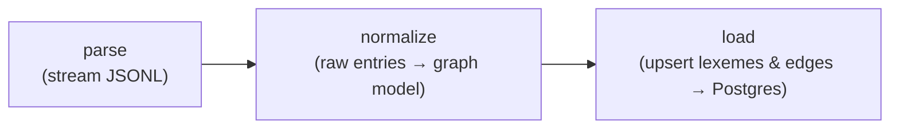

# etymyriad (etl)

The offline ETL that turns Wiktextract data into the etymology graph.



## Usage

```sh
uv sync  # install (fetches Python 3.13)
# DATABASE_URL/WIKTEXTRACT_DUMP/WIKTEXTRACT_DUMP_DATE all default to
# the standard local dev DB and acquired-dump path (see config.py);
# set them yourself only to override one (e.g. a Neon migration).

# One-time: kaikki.org only distributes one combined dump (every language
# mixed together). Filter it down to Indo-European first:
uv run etymyriad filter-ine --input raw-wiktextract-data.jsonl.gz \
                             --output ../data/raw/indo-european.jsonl

uv run etymyriad all        # parse + normalize + load
uv run etymyriad parse      # parse only (inspect intermediate output)
uv run pytest               # tests
```
