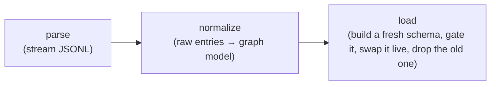

# etymyriad (etl)

The offline ETL that turns Wiktextract data into the etymology graph.



## Usage

```sh
uv sync  # install (fetches Python 3.13)
# DATABASE_URL defaults to the standard local dev DB (see config.py), and
# every dump reader defaults to the newest filtered dump in ../data/.
# load, all, and crosscheck read the dump date off kaikki.org, so they
# need network access and a dump kaikki.org still serves.

# Once per dump: kaikki.org only distributes one combined dump (every language
# mixed together). Narrow it to the languages and fields in scope first. This
# writes ../data/etymyriad-data.jsonl:
uv run etymyriad filter --input ../data/raw-wiktextract-data.jsonl.gz

uv run etymyriad --help     # every command and its options
uv run pytest               # tests
```
