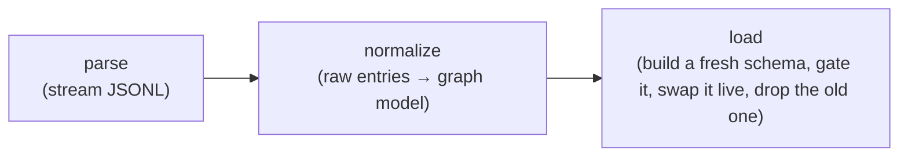

# etymyriad (etl)

The offline ETL that turns Wiktextract data into the etymology graph.



## Usage

```sh
uv sync  # install (fetches Python 3.13)
# DATABASE_URL and WIKTEXTRACT_DUMP default to the standard local dev DB
# and acquired-dump path (see config.py). load and all need
# WIKTEXTRACT_DUMP_DATE=YYYY-MM-DD.

# Once per dump: kaikki.org only distributes one combined dump (every language
# mixed together). Filter it down to Indo-European first:
uv run etymyriad filter-ine --input raw-wiktextract-data.jsonl.gz \
                             --output ../data/raw/indo-european.jsonl

uv run etymyriad --help     # every command and its options
uv run pytest               # tests
```
