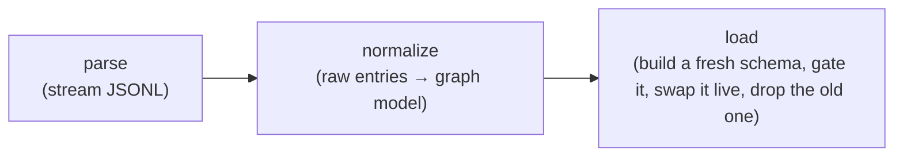

# etymyriad (etl)

The offline ETL that turns Wiktextract data into the etymology graph.



## Usage

```sh
uv sync  # install (fetches Python 3.13)
# DATABASE_URL defaults to the standard local dev DB (see config.py), and
# every dump reader reads ../data/etymyriad-data.jsonl, which filter writes.
# load and crosscheck take the dump date from the raw dump's file name; all
# and fetch-dump read kaikki.org, so they need network access.

# kaikki.org only distributes one combined dump (every language mixed
# together). fetch-dump downloads it to
# ../data/wiktextract-data-<date>.jsonl.gz unless that file is already there,
# and prints the path. `all` does this itself.
uv run etymyriad fetch-dump

# Narrow the dump to the languages and fields in scope. This writes
# ../data/etymyriad-data.jsonl:
uv run etymyriad filter --input ../data/wiktextract-data-<date>.jsonl.gz

uv run etymyriad --help     # every command and its options
uv run pytest               # tests
```
